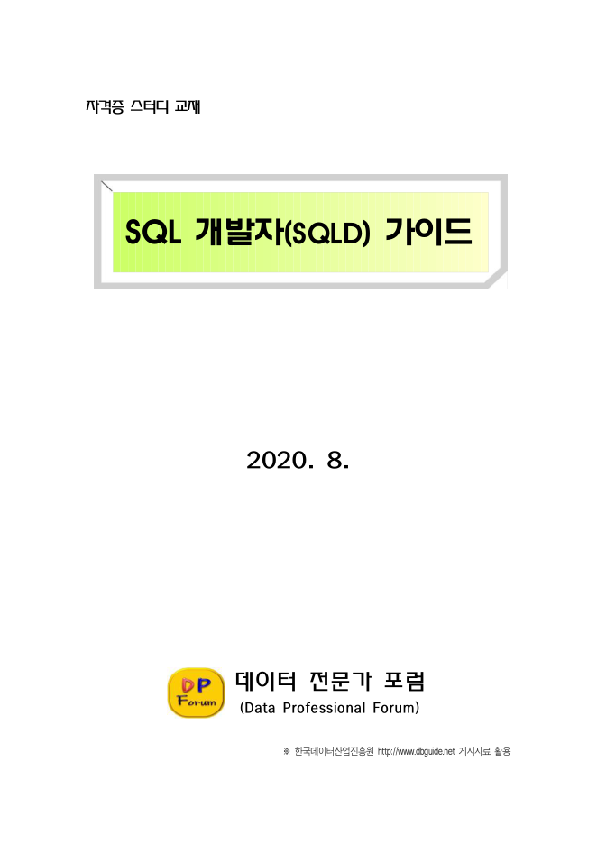
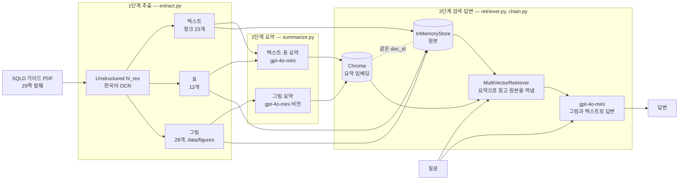
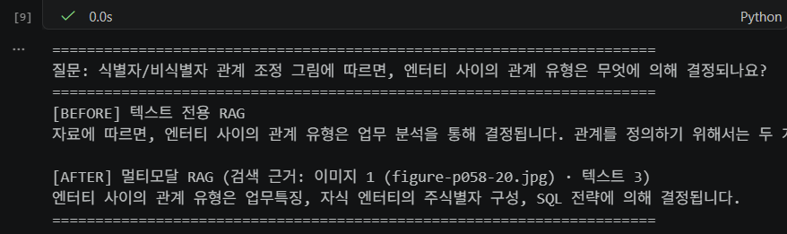

# SQLD 가이드 멀티모달 RAG

SQLD 가이드 멀티모달 RAG는 SQL 학습자료 PDF에서 텍스트, 표, 그림을 함께 검색하고 답하는 파이프라인입니다. 입력한 텍스트, 표, 그림을 각각 요약문으로 색인해서 검색하고 출력할 때는 원본(그림 이미지, 표 원문)을 멀티모달 LLM 모델에게 전달합니다. 동일한 질문을 텍스트 전용 RAG에게도 던져 두 결과를 비교합니다.

## 제출물

| 제출물 | 위치 |
|---|---|
| 깃허브 저장소 | 공개 저장소. `.env`는 올리지 않습니다 ([.gitignore](.gitignore)) |
| README | 본 문서 — [문제 정의](#1-문제-정의), [아키텍처](#3-아키텍처), [실행 방법](#6-실행-방법), [한계](#8-한계) |
| 아키텍처 다이어그램 | [3장](#3-아키텍처), Mermaid로 직접 작성 |
| 실행 노트북 | [notebooks/multimodal_rag.ipynb](notebooks/multimodal_rag.ipynb), 실행 결과 셀 포함 |
| Before/After 비교 | [7장 결과](#7-결과)의 캡처와 차이 설명 |
| 질의응답 5건 | [7장 결과](#7-결과)의 표 (질문 / 답변 / 근거가 된 원본 종류) |

## 1. 문제 정의

- **PDF 선정 이유**: 2026년 11월 14일에 SQLD(SQL 개발자) 시험이 예정되어 참고서로 사용 중인 「SQL 개발자(SQLD) 가이드」를 골랐습니다.
- **입력 데이터의 특성**: 본 pdf 문서는 개념을 그림과 표로 설명하며 그 안의 정보 일부는 본문 문장에 다시 나오지 않습니다.
  - 그림에만 있는 정보: "엔터티 사이 관계 유형은 업무 특징, 자식 엔터티의 주식별자 구성, SQL 전략에 의해 결정된다"는 문장은 [그림 Ⅰ-1-46] 안에만 있습니다. 교육이력 엔터티의 주식별자(사번 + 수강일자, 복합식별자)도 [그림 Ⅰ-1-42]에만 있습니다.
  - 표에만 있는 정보: SQL 예제의 실행 결과 값(예: SYS_CONNECT_BY_PATH 예제에서 사원 D의 경로 `/A/C/D`)은 실행 결과 표에 있고 추출하면 텍스트가 아니라 표로 분리됩니다.
- **문제**: 텍스트만 임베딩하는 RAG는 그림 속 글자와 표의 값을 검색하지 못합니다. 그래서 그림과 표를 보면 바로 답이 나오는 질문에도 모른다고 하거나 두루뭉술하게 답합니다.
- **목표**: 그림과 표까지 검색 대상에 반영하여 근거가 그림과 표에만 있는 질문에도 답할 수 있게 설계하였습니다. 뿐만 아니라 동일한 질문을 텍스트 전용 RAG에도 던져 차이를 확인하고자 하였습니다.

## 2. 데이터



- **대상 문서**: 「SQL 개발자(SQLD) 가이드」 (2020.8, 445쪽, 편집: 데이터 전문가 포럼 — 표지 표기)
  - **성격**: 한국데이터산업진흥원(Kdata)이 DBguide.net에 공개 게시했던 「SQL 전문가 가이드」의 과목 Ⅰ과 Ⅱ를 엮은 비공식 학습자료입니다.
  - **웹 출처**: [archive.org 보관본 (데이터 모델링의 이해)](https://web.archive.org/web/20200807103422/http://www.dbguide.net/db.db?cmd=view&boardUid=148181&boardConfigUid=9&categoryUid=216&boardIdx=132&boardStep=1)
  - **수록 범위**: 2020년 [SQLD 출제범위](https://web.archive.org/web/20201128155440/https://www.dataq.or.kr/www/sub/a_04.do) 2과목(데이터 모델링의 이해, SQL 기본 및 활용 — SQL 최적화 기본 원리 포함)과 같습니다.
  - PDF 원본은 저장소에 올리지 않았습니다 (`.gitignore`의 `*.pdf`). 원 자료의 저작권은 한국데이터산업진흥원에 있습니다. 실행하려면 `data/`에 PDF를 넣어야 합니다.

### 과제의 PDF 선정 기준

| 기준 | 본 PDF 문서 |
|---|---|
| 텍스트와 함께 그래프 또는 표 2개 이상 | 사용한 29쪽에서 그림 28개, 표 12개를 추출 |
| 10~30페이지 분량 | 445쪽 중 두 구간 29쪽만 잘라서 사용 |
| 공개 자료 | 한국데이터산업진흥원이 DBguide.net에 공개 게시한 가이드를 엮은 학습자료 (위 원 게시처 참고) |

### 사용 구간

| 구간 | PDF 쪽 | 내용 | 고른 이유 |
|---|---|---|---|
| 관계와 식별자 | 44~58 (15쪽) | 1과목 1장 4절 관계, 5절 식별자 앞부분 | ERD와 식별자 그림 20개 |
| 계층형 질의와 셀프 조인 | 324~337 (14쪽) | 2과목 2장 3절 | 계층 구조 그림 8개, 실행 결과와 함수 설명 표 |

- 쪽 번호는 PDF 뷰어 기준입니다(책에 인쇄된 쪽 + 3). 추출한 그림 파일 이름에도 원본 PDF 쪽 번호가 붙습니다(`figure-p058-20.jpg`).
- 스캔본이 아니라 텍스트 층이 있어서 본문 글자는 그대로 출력됩니다. 다만 추출 결과에서 마침표 위치가 어긋나거나 장과 절 번호가 빠진 곳이 있습니다. (e.g. "제 장 데이터 모델링의 이해", "말할 수 있다 이 . 것을").

## 3. 아키텍처



- 검색은 요약으로, 답변은 원본으로 합니다. 요약과 원본은 동일한 `doc_id`로 연결됩니다 (MultiVectorRetriever).
- 평가: `evaluate.py`가 동일한 질문을 텍스트 전용 RAG(텍스트 청크만 색인, 지시문과 모델은 같음)에도 던지고 `compare.py`가 두 답을 채점합니다.

### 코드 구성

| 파일 | 역할 |
|---|---|
| `notebooks/multimodal_rag.ipynb` | 실행 노트북 — 아래 모듈을 단계별로 실행하고 결과를 남김 |
| `main.py` | 명령줄 실행 (`extract` / `summarize` / `ask` / `evaluate` / `compare`) |
| `src/config.py` | 경로, 구간, 모델, 평가 질문 (바꿀 값은 여기만) |
| `src/extract.py` | 1단계: 구간 자르기, 텍스트, 표, 그림 추출, 텍스트 분할 |
| `src/summarize.py` | 2단계: 텍스트, 표, 그림 요약 |
| `src/retriever.py` | 3단계: 다중 벡터 검색기, 비교용 텍스트 전용 검색기 |
| `src/chain.py` | 3단계: 멀티모달 체인, 비교용 텍스트 전용 체인 |
| `src/evaluate.py` | 평가: 질문 5개를 두 체인에 던져 Before/After와 질의응답 표 생성 |
| `src/compare.py` | 평가: 두 결과를 정답 키워드와 근거 검색으로 채점 |

## 4. 구조 이해 — 왜 요약으로 찾고 원본으로 답하나

- **요약으로 검색하는 이유**: 질문은 글자인데 그림은 픽셀이라 그대로는 질문과 비교 불가. 그림을 글로 요약해 둬야 질문과 동일한 텍스트 임베딩으로 비교 가능. 표랑 긴 텍스트도 요약하면 핵심 단어만 남아서 질문과 더 잘 맞음.
- **원본으로 답하는 이유**: 요약은 찾는 용도고 답하는 용도는 아님. 요약에는 표 값이나 그림 세부 내용이 빠져서 요약만 넘기면 모델이 대충 답함. 그래서 찾은 다음엔 원본을 넘기고 그림은 이미지 그대로 넘겨서 모델이 직접 보게 함.
- **`doc_id`가 하는 일**: 요약(Chroma)과 원본(InMemoryStore)에 동일한 `doc_id`를 붙임. 도서관 색인 카드와 책을 잇는 청구기호랑 같음. 이 번호가 없으면 요약으로 찾아도 어떤 원본을 꺼낼지 모름.
- **실행에서 확인한 것**: 노트북 3-1 셀에서 1번 질문을 넣으면 벡터 DB는 [그림 Ⅰ-1-46] 요약문("업무특징, SQL Join, 자식 엔터티 주식별자 구성…")을 2순위로 찾음. 검색기는 그 요약 대신 짝인 원본 `figure-p058-20.jpg`를 돌려줌. 답변 모델은 이 그림을 직접 보고 답함.

## 5. 기술 선택 근거

| 항목 | 선택 | 근거 |
|---|---|---|
| 추출 | Unstructured `hi_res`, `infer_table_structure=True`, `languages=["kor", "eng"]` | 레이아웃 모델로 그림과 표 영역을 따로 잡아야 텍스트와 나눠서 요약하고 원본을 보관할 수 있습니다. 한국어 자료이고 SQL 키워드는 영어라서 OCR 언어를 둘 다 지정했습니다. |
| 쪽 범위 | 445쪽 중 29쪽 | 과제 기준(10~30쪽)과 요약 비용을 맞추면서 그림이 많은 구간과 표가 많은 구간을 하나씩 골랐습니다. |
| 텍스트 분할 | 2,000토큰, 200토큰 겹침 | 수업 기준값입니다. 추출한 텍스트 블록 19개를 이어 붙인 뒤 문단 경계에서 2,000토큰 이하로 다시 묶어 청크 23개가 됩니다. 분할기가 gpt2 토큰으로 세기 때문에 한국어에서는 청크 평균이 약 1,150자(gpt-4o-mini 토큰으로 약 580)라서 한 청크에 개념이 한두 개 들어갑니다. 겹침 200토큰으로 청크 경계의 문맥이 이어집니다. |
| 요약 모델 | gpt-4o-mini, temperature 0 | 비전을 지원하고 요약 호출이 63건(텍스트 23, 표 12, 그림 28)이라 저렴한 모델을 썼습니다. 요약은 내용을 받아 적는 작업이라 temperature를 0으로 두어 다시 실행해도 요약이 덜 바뀌게 했습니다. |
| 답변 모델 | gpt-4o-mini, temperature 0 (텍스트 전용 RAG도 동일한 모델) | 사용한 OpenAI API 프로젝트에서는 gpt-4o 권한이 없어서(403) 호출할 수 있는 비전 모델로 정했습니다. 두 RAG가 동일한 모델과 지시문을 쓰므로 답의 차이는 그림과 표를 넘겼는지에서만 생깁니다. |
| 임베딩 | text-embedding-3-small | 한국어 요약문을 색인하는 데 썼습니다. 저렴하고 수업과 동일한 모델입니다. |
| 프롬프트 언어 | 텍스트와 표 요약: 한국어 / 그림 요약: 영어 지시 + 한국어 출력 / 답변 지시: 한국어 | 자료와 질문이 한국어라서 요약도 한국어여야 동일한 언어끼리 임베딩이 맞습니다. 그림 요약은 수업의 영어 지시문을 유지하고 출력만 한국어로 정하고 그림 캡션, 이름, 숫자, 그림 속 문장을 담도록 항목을 보강했습니다. |
| 표 요약 프롬프트 | 텍스트와 따로 두고 열 이름과 각 행의 값을 그대로 남기도록 지시 | 표는 값 자체가 정보입니다. 텍스트와 동일한 수업 프롬프트로 요약하면 값이 빠져서(예: 실행 결과 표의 경로 `/A/C/D`가 요약에서 사라짐) 값을 묻는 질문에 표가 검색되지 않습니다. OCR로 깨진 띄어쓰기는 바로잡되 표에 없는 값은 만들지 않게 했습니다. |
| 이미지 전달 | `detail: high`, 지시문에 "위 그림도 자료" 문장 추가 | 기본값 `auto`는 모델이 저해상도(512px)로 볼 수 있어서 그림 속 작은 글자를 놓칠 수 있습니다. 지시문이 "아래 자료"라고만 하면 위에 붙인 그림을 근거로 쓰지 않을 수 있어서 한 줄을 더했습니다. |
| 검색 개수 | k = 4 | 수업 기준값입니다. 그림, 표, 텍스트가 섞여 나올 여유가 있습니다. |
| 작은 그림 제외 | 짧은 변 100px 미만, 똑같은 그림 중복 제외 | 아이콘 요약에 드는 비용과 검색 잡음을 줄입니다. 이 구간에서는 제외된 그림이 없었습니다. |

## 6. 실행 방법

준비물: Python 3.11, Poppler, Tesseract(한국어 `kor` 데이터 포함), OpenAI API 키(gpt-4o-mini와 text-embedding-3-small을 쓸 수 있는 키)

실행을 확인한 버전 (Python 3.11.9, Windows):

```bash
python -m venv .venv
.venv\Scripts\activate              # macOS/Linux: source .venv/bin/activate
pip install langchain==1.4.8 langchain-core==1.7.4 langchain-classic==1.0.8 langchain-openai==1.7.3 langchain-chroma==1.1.0 langchain-text-splitters==1.1.3 chromadb==1.5.9 openai==3.44.0 "unstructured[pdf]==0.27.36" unstructured-inference==1.6.17 pypdf==6.21.4 pillow==13.0.0 tiktoken==0.14.0 python-dotenv==1.2.4 ipykernel
copy .env.example .env              # macOS/Linux: cp .env.example .env  → .env 에 API 키 입력
```

`data/`에 PDF 1개를 넣은 다음 둘 중 하나로 실행합니다.

- **노트북**: `notebooks/multimodal_rag.ipynb`를 열고 위에서부터 실행합니다(Run All). 1단계 추출 → 2단계 요약 → 3단계 검색과 체인 → 평가 순서입니다.
- **명령줄** (프로젝트 루트에서):

  ```bash
  python main.py extract          # 1단계: 텍스트·표·그림 추출 (29쪽 약 2분)
  python main.py summarize        # 2단계: 요약 생성 (OpenAI API 비용 발생)
  python main.py ask "질문"        # 질문 하나로 검색된 원본과 답변 확인
  python main.py evaluate         # 평가: Before/After, 질의응답 5건 표, 두 결과 비교 → docs/
  python main.py compare          # 저장된 평가 결과로 다시 채점만 (API 호출 없음)
  ```

## 7. 결과

실행 노트북([notebooks/multimodal_rag.ipynb](notebooks/multimodal_rag.ipynb))의 결과입니다.

### 추출과 요약

- 29쪽에서 텍스트 청크 23개, 표 12개, 그림 28개를 추출했고(`data/figures/`), 63건을 모두 요약해서 색인했습니다.
- 그림 요약 예시 ([그림 Ⅰ-1-46]): "엔터티 사이 관계유형은 업무특징, 자식엔터티의 주식별자구성, SQL 전략에 의해 결정됨" — 그림 속 문장을 그대로 옮겨서 검색에 걸립니다.
- 표 요약 예시 (SYS_CONNECT_BY_PATH 실행 결과): 열 이름(루트사원, 경로, 사원, 관리자)과 `/A/C/D`를 포함한 모든 행이 요약에 남았습니다.

### Before / After



- **Before (텍스트 전용)**: "업무 분석을 통해 결정"이라고 본문의 관계 도출 설명을 끌어와 그럴듯하게 답했지만 정답이 아닙니다. 정답 문장은 그림 안에만 있어서 텍스트 검색으로는 찾을 수 없습니다.
- **After (멀티모달)**: 그림 요약으로 [그림 Ⅰ-1-46]을 찾고 원본 그림을 보고 "업무특징, 자식 엔터티의 주식별자 구성, SQL 전략"을 정확히 답했습니다.

### 질의응답 5건

멀티모달 RAG의 답변입니다. 채점은 아래 [두 결과 비교](#두-결과-비교)에 있습니다.

| # | 질문 | 답변 | 근거가 된 원본 종류 |
|---|---|---|---|
| 1 | 식별자/비식별자 관계 조정 그림에 따르면, 엔터티 사이의 관계 유형은 무엇에 의해 결정되나요? | 엔터티 사이의 관계 유형은 업무특징, 자식 엔터티의 주식별자 구성, SQL 전략에 의해 결정됩니다. | 이미지 1 (figure-p058-20.jpg), 텍스트 3 |
| 2 | 식별자의 분류 그림에서 교육이력 엔터티의 주식별자는 어떤 속성들로 구성되고, 어떤 식별자로 분류되나요? | 교육이력 엔터티의 주식별자는 "주식별자"로 분류되며, 다음과 같은 속성들로 구성됩니다: 1. **유일성**: 주식별자에 의해 엔터티 내의 모든 인스턴스들이 유일하게 구분되어야 합니다. 2. **최소성**: 주식별자를 구성하는 속성의 수는 유일성을 만족하는 최소의 수가 되어야 합니다. 3. **불변성**: 지정된 주식별자의 값은 자주 변하지 않아야 합니다. 4. **존재성**: 주식별자가 지정되면 반드시 값이 들어와야 합니다. 이러한 속성들은 주식별자의 특성에 해당합니다. | 이미지 3 (figure-p054-14.jpg, figure-p053-13.jpg, figure-p053-12.jpg), 텍스트 1 |
| 3 | SYS_CONNECT_BY_PATH 함수 예제의 실행 결과에서 사원 D의 경로는 무엇인가요? | 사원 D의 경로는 "A/C/D"입니다. | 이미지 1 (figure-p328-26.jpg), 표 1, 텍스트 2 |
| 4 | 계층형 질의에서 CONNECT_BY_ROOT는 무엇을 표시하고, 어떤 종류의 연산자인가요? | CONNECT_BY_ROOT는 현재 전개할 데이터의 루트 데이터를 표시하는 단항 연산자입니다. 이 함수는 계층형 질의에서 루트 데이터부터 현재 전개할 데이터까지의 경로를 나타냅니다. | 이미지 1 (figure-p328-26.jpg), 표 2, 텍스트 1 |
| 5 | 계층형 질의에서 START WITH절과 CONNECT BY절은 각각 무엇을 지정하나요? | 계층형 질의에서 `START WITH` 절은 계층 구조의 시작점을 지정하며, `CONNECT BY` 절은 부모와 자식 간의 관계를 정의하여 계층 구조를 탐색하는 데 사용됩니다. `START WITH` 절에 의해 지정된 조건을 만족하는 데이터가 루트 노드가 되고, `CONNECT BY` 절에 의해 정의된 조건에 따라 하위 데이터가 연결됩니다. | 이미지 2 (figure-p325-22.jpg, figure-p328-26.jpg), 표 1, 텍스트 1 |

### 두 결과 비교

질문 5개는 정답 근거의 원본 종류가 섞이도록 골랐습니다(이미지 2, 표 2, 텍스트 1). 이미지 질문 2개는 정답이 PDF 텍스트 층과 추출 텍스트에 없고 그림에만 있습니다. `compare.py`가 두 RAG의 답을 규칙으로 채점합니다.

- **정답**: 질문마다 정한 정답 키워드가 답변에 모두 들어 있으면 정답, 일부면 부분, 모른다고 답하면 모름으로 셉니다(띄어쓰기 무시). LLM 채점이 아니라서 다시 돌려도 동일한 결과가 나옵니다.
- **근거 검색**: 정답 근거가 검색됐는지 봅니다. 이미지는 정답 그림의 쪽 번호, 표와 텍스트는 정답 문구가 든 원본으로 판단합니다. 답이 틀렸을 때 검색 문제인지 판독 문제인지 나눌 수 있습니다. 4번의 [표 Ⅱ-2-3]은 PDF에 그림으로 들어 있는 표라서 표 요소(OCR)와 그림 파일로 함께 추출되므로 그 그림이 검색돼도 적중으로 셉니다.

#### 질문별 채점 (정답 키워드 기준, 번호는 질의응답 표와 같음)

| # | 구간 | 정답 근거 | 정답 키워드 | 근거 검색 | Before 텍스트 전용 | After 멀티모달 |
|---|---|---|---|---|---|---|
| 1 | 관계와 식별자 | 이미지 (58쪽) | 업무, 특징, 주식별자, SQL | 적중 | 부분 (1/4) | 정답 (4/4) |
| 2 | 관계와 식별자 | 이미지 (54쪽) | 수강일자, 복합식별자 | 적중 | 모름 (0/2) | 오답 (0/2) |
| 3 | 계층형 질의와 셀프 조인 | 표 (328쪽) | /A/C/D | 빗나감 | 오답 (0/1) | 오답 (0/1) |
| 4 | 계층형 질의와 셀프 조인 | 표 (328쪽) | 루트, 단항 | 적중 | 부분 (1/2) | 정답 (2/2) |
| 5 | 계층형 질의와 셀프 조인 | 텍스트 (325쪽) | 시작, 루트, 자식 | 빗나감 | 정답 (3/3) | 정답 (3/3) |

#### 근거 종류별 요약

| 근거 종류 | 문항 | 근거 검색 | Before 정답 (키워드) | After 정답 (키워드) |
|---|---|---|---|---|
| 이미지 | 2 | 2/2 | 0/2 (1/6) | 1/2 (4/6) |
| 표 | 2 | 1/2 | 0/2 (1/3) | 1/2 (2/3) |
| 텍스트 | 1 | 0/1 | 1/1 (3/3) | 1/1 (3/3) |
| 전체 | 5 | 3/5 | 1/5 (5/12) | 3/5 (9/12) |

#### 구간별 요약

| 구간 | 문항 | 근거 검색 | Before 정답 (키워드) | After 정답 (키워드) |
|---|---|---|---|---|
| 관계와 식별자 (44~58쪽) | 2 | 2/2 | 0/2 (1/6) | 1/2 (4/6) |
| 계층형 질의와 셀프 조인 (324~337쪽) | 3 | 1/3 | 1/3 (4/6) | 2/3 (5/6) |
| 전체 | 5 | 3/5 | 1/5 (5/12) | 3/5 (9/12) |

**해석**
- 멀티모달 RAG가 5문항 중 3문항을 맞혀 텍스트 전용(1문항)보다 2문항 많았고 정답 키워드도 5/12 → 9/12로 늘었습니다. 차이는 정답이 그림과 표에 있는 1번과 4번에서 났습니다.
- **1번 (그림)**: 정답이 그림에만 있어서 텍스트 전용은 엉뚱한 본문으로 답했고 멀티모달은 그림을 찾아 맞혔습니다.
- **4번 (그림으로 된 표)**: 멀티모달은 표 요소와 표 그림을 함께 받아 "루트 데이터를 표시하는 단항 연산자"라고 맞혔습니다. 다만 뒤 문장에서 SYS_CONNECT_BY_PATH의 설명(경로 표시)을 섞어 붙였습니다.
- **2번 (그림, 실패)**: 정답 그림 `figure-p054-15.jpg`는 검색되지 않고 같은 쪽의 다른 표 그림(p054-14)과 주식별자 특징 표가 검색되어 "주식별자의 특징"을 속성으로 잘못 답했습니다. 근거 검색은 쪽 번호로만 판정해서 "적중"으로 나오지만 실제로는 빗나간 경우입니다.
- **3번 (표, 실패)**: 두 RAG 모두 "A/C/D"로 답해 실제 값 `/A/C/D`의 맨 앞 `/`가 빠졌습니다. 정답 표는 이번에도 검색되지 않았고 본문의 SQL 예제와 계층 구조로 추론한 답입니다.
- **5번 (텍스트)**: 두 RAG 모두 맞혔습니다. 멀티모달은 정답 문장이 든 청크 대신 구문 그림과 다른 청크로 답했습니다. 색인에 그림 요약이 함께 들어가면서 텍스트 청크가 검색 순위에서 밀리는 경우가 있습니다.

## 8. 한계

- `InMemoryStore`와 Chroma가 메모리에만 있어서 실행할 때마다 색인을 다시 만듭니다. 실제 서비스라면 docstore는 LocalFileStore나 Redis로, Chroma는 `persist_directory`로 디스크에 저장해야 합니다.
- PDF 안의 그림 원본이 500~640px로 작아서 그림 요약에 오독이 남습니다. 예: [그림 Ⅰ-1-42]의 "수강일자"를 "강의일자"로, "본질식별자"를 "분질식별자"로, 인조식별자 그림의 "일련번호"를 "입력번호"로 읽었습니다.
- 근거 검색 판정은 그림을 쪽 번호로만 봐서 같은 쪽의 다른 그림이 검색돼도 적중으로 셉니다(2번).
- 답변 모델 gpt-4o-mini는 그림 속 화살표 방향이나 트리 위치처럼 관계를 따져야 하는 내용을 잘못 읽는 경우가 있습니다. 평가 질문 5개는 그림과 표 속 글자를 읽으면 답이 나오는 질문이라 이런 판독 능력까지는 확인하지 못했습니다.
- 추출 단계가 그림 속 글자를 OCR해서 텍스트 청크에 넣기 때문에 텍스트 전용 RAG도 그림 속 글자를 깨진 형태로는 볼 수 있습니다. 비교 기준이 "그림 정보가 전혀 없는" 상태는 아닙니다.
- 모든 쪽의 머리글과 바닥글("Kdata 데이터자격검정", 쪽 번호)이 텍스트 청크에 섞여 들어갑니다.
- 요약에 엔터티와 속성 이름이 빠지면 그 그림은 검색되지 않습니다.
- 키워드 채점은 같은 뜻을 다른 말로 쓰면 부분이나 오답으로 셉니다. 판정이 애매하면 `docs/eval_results.json`의 답변 원문으로 확인합니다.
- 질문이 5개뿐이고 한 번 실행한 결과라서 temperature 0이어도 그림 판독은 실행마다 조금 달라질 수 있습니다.
- 본 PDF 문서는 2024년 무렵 개편 전의 SQLD 출제범위입니다.
